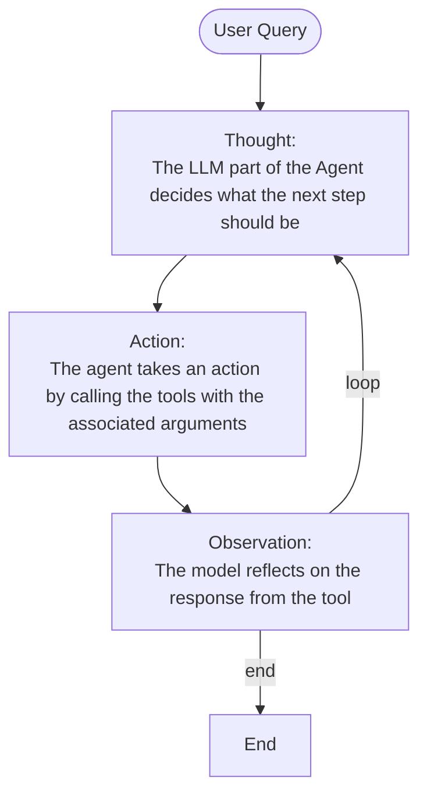

# Notes: `Agents Course` Hugging Face

## Tools

Uma tool deve ter:
- um descrição textual do que a funcao faz
- um Callable
- argumentos com typings
- (opcional) outputs com typings

Usa-se o system prompt para dar as descrições textuais das tools disponiveis.

Exemplo:
```
system_message="""You are as AI assistant...

You have access to the following tools:
{toools_description}
"""
```

Exemplo de função:
```python
def calculator(a: int, b: int) -> int:
    """Multiply two integers."""
    return a * b
```

Texto que descreve esta função: `Tool Name: calculator, Description: Multiply two integers., Arguments: a: int, b: int, Outputs: int`

### Auto-formatting Tool sections

Ao usar o decorator para indicar a funcao como tool:
```python
@tool
def calculator(a: int, b: int) -> int:
    """Multiply two integers."""
    return a * b

print(calculator.to_string())
```

Ao chamar `.to_string()` obtem-se `Tool Name: calculator, Description: Multiply two integers., Arguments: a: int, b: int, Outputs: int`

### Generic Tool implementation

Cria-se uma classe `Tool` generica:
```python
from typing import Callable


class Tool:
    """
    A class representing a reusable piece of code (Tool).

    Attributes:
        name (str): Name of the tool.
        description (str): A textual description of what the tool does.
        func (callable): The function this tool wraps.
        arguments (list): A list of arguments.
        outputs (str or list): The return type(s) of the wrapped function.
    """
    def __init__(self,
                 name: str,
                 description: str,
                 func: Callable,
                 arguments: list,
                 outputs: str):
        self.name = name
        self.description = description
        self.func = func
        self.arguments = arguments
        self.outputs = outputs

    def to_string(self) -> str:
        """
        Return a string representation of the tool,
        including its name, description, arguments, and outputs.
        """
        args_str = ", ".join([
            f"{arg_name}: {arg_type}" for arg_name, arg_type in self.arguments
        ])

        return (
            f"Tool Name: {self.name},"
            f" Description: {self.description},"
            f" Arguments: {args_str},"
            f" Outputs: {self.outputs}"
        )

    def __call__(self, *args, **kwargs):
        """
        Invoke the underlying function (callable) with provided arguments.
        """
        return self.func(*args, **kwargs)
```

Depois pode-se usar a class tool assim:
```python
def calculator(a, b):
    return a * b
calculator_tool = Tool(
    "calculator",                   # name
    "Multiply two integers.",       # description
    calculator,                     # function to call
    [("a", "int"), ("b", "int")],   # inputs (names and types)
    "int",                          # output
)
```

### Model Context Protocol (MCP)

É um open protocol que standardizes como apps disponibilizam tools a LLMs

Ver melhor em [HF MCP course](https://huggingface.co/learn/mcp-course/unit0/introduction)

## Thought-Action-Observation Cycle



Geralmente, as rules e guidelines são embedded diretamente no system prompt, garantindo a mesma logica em todos os ciclos.

Exemplo:
```
system_message="""Your are an AI assistant ...

You have access to the following tools:
{toools_description}

You should think step by step in order to fulfill the objective with a reasoning divided into Thought/Action/Observation steps that can be repeated multiple times if needed.

You should first reflect on the current situation using `Thought: {your_thoughts}`, then (if necessary), call a tool with the proper JSON formatting `Action: {JSON_BLOB}`, or print your final answer starting with the prefix `Final Answer`
"""
```

## Thoughts

### Chain-of-Thought (CoT) 

É um tecnica de prompting que guia o modelo a pensar um problema passo a passo antes de chegar a uma resposta final.

Ajuda o raciocinio interno do modelo, especialmente para tarefas logicas ou matematicas, sem interagir com tools externas.

### ReAct: Reasoning + Acting

É uma tecnica de prompting que encoraga o modelo a pensar passo a passo e ações(como usar tools) intercaladas entre os passos de raciocinio.

## Actions

Tipos de agents que recebem actions:
| Tipo                | Descrição                                                                   |
| :------------------ | --------------------------------------------------------------------------- |
| JSON agent          | action especificada em formato JSON                                         |
| Code agent          | agente escreve o codigo que é interpretado externamente                     |
| Funct-calling agent | JSON agent que foi fine-tunned para gerar uma nova menssagem para cada ação |

Tipos de propositos das ações:
...

### Stop and Parse Approach

Metodo para garantir que o output do agente é estruturado e previsivel:
1. Generation in a Structured Format:
2. Halting Further Generation: depois do texto que define a ação foi emitido, pára de gerar tokens adicionais
3. Parsing the Output: um parser externo lê a ação formatada, determina a tool a ser chamada e extrai os parametros necessarios

### Code Agents

Code agent gera um code block executavel.

Pros:
- expressividade: codigo expressa melhor logica complexa e é mais flexivel
- modularidade e reutilização: 
- debugging melhor:
- integração direta:

Pode impor riscos de segurança, recomenda-se usar frameworks como `smolagents`, `llamaindex`, `langgraph` que integram safeguards.


## Observations

Nesta faze o agent:
- Collects Feedback: recebe os dados ou confirmacao que a ação foi executada ou nao
- Appends Results: integra nova info no seu contexto
- Adapts its Strategy: usa o novo contexto para refinar thoughts e actions

Como append results:
1. parse action para identificar a função a chamar e os argumentos a usar
2. executa a ação
3. anexa o resultado como uma Observation

## Framework: smolagents

## Framework: LlamaIndex

## Framework: LangGraph

